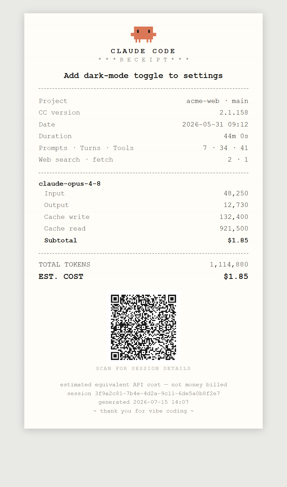

# claude-receipt

Generate a **receipt** (Markdown + HTML) for a Claude Code session — tokens, models,
tool calls, duration, and estimated cost. Works for sessions run in the **official
Claude Code VS Code extension** and the terminal CLI, on Windows/macOS/Linux.

Inspired by [chrishutchinson/claude-receipts](https://github.com/chrishutchinson/claude-receipts).
Printing is out of scope; the output is a `.md` + a self-contained `.html`.

<p align="center">
  
  <br><em>Example HTML receipt (sample data).</em>
</p>

## How it works

Claude Code (both the extension and the CLI — same engine) stores every session as a
JSONL transcript under `~/.claude/projects/<encoded-cwd>/<session-id>.jsonl`. This tool
reads that file directly, so it needs no API key and works offline.

```
~/.claude/projects/**.jsonl → discover → parse → aggregate(dedup) → price → render → .md + .html
```

The one subtlety it handles: a single assistant API response is written as **multiple
JSONL lines** that each repeat the `usage` object, so usage is deduped by
`message.id` before summing (otherwise tokens are counted 3–4×). Sub-agent
transcripts also write mid-stream snapshots of a response with only a few output
tokens, so each response is counted from its final row.

## Install

From zero to your first receipt:

**1. Install Node.js 22 or newer.** Check with `node --version`. That's the only
prerequisite — this tool has **no dependencies and no build step** (it uses only
Node's built-in modules).

**2. Get the code.**

```bash
git clone https://github.com/pawagit/claude-receipt.git
cd claude-receipt
```

**3. Confirm it can see your sessions.**

```bash
node bin/receipt.js --list
```

You should see a list of your recent Claude Code sessions. No API key is needed —
the tool reads the local transcripts under `~/.claude/projects/`.

**4. Generate your first receipt.**

```bash
node bin/receipt.js --open
```

This receipts your most recent session, writes a `.md` + `.html` into that
session's project folder, and opens the HTML.

**5. (Optional) Wire it into Claude Code.** For a receipt automatically at the
end of every session, plus the `/receipt` and `/receipt-rebuild` slash commands,
run the installer:

```bash
npm run setup          # or: node scripts/install.js
```

It adds a `SessionEnd` hook and the `/receipt` and `/receipt-rebuild` commands to
your global `~/.claude/` config, filling in this clone's absolute path for you — no
manual path editing. It merges into any existing `settings.json` (keeping the
original as `settings.json.bak`), is safe to re-run, and undoes cleanly with
`node scripts/install.js --uninstall`. Open `/hooks` once (or restart) to load the
hook into a running session. See **Auto-generate on every session** for exactly
what it configures, or to set it up by hand. After updating this clone, run
`npm run setup` again to refresh the slash commands.

For a shorter `claude-receipt` command instead of `node …/bin/receipt.js`, see
**Optional: install as a terminal command**.

## Usage

```bash
node bin/receipt.js                  # the current session inside Claude Code, else the latest
node bin/receipt.js --latest         # the latest session anywhere
node bin/receipt.js --session <id>   # a specific session (full id or unique prefix)
node bin/receipt.js --project <dir>  # latest session whose cwd matches <dir>
node bin/receipt.js --list           # list available sessions
node bin/receipt.js --open           # also open the HTML when done
```

Run inside Claude Code (from `/receipt`, or by Claude), it receipts **the session it
runs in**, read from the `CLAUDE_CODE_SESSION_ID` environment variable, even while
other sessions are running in parallel.

| Flag | Meaning |
|---|---|
| `--latest` | Receipt the most recently active session anywhere |
| `--session <id>` | Receipt a specific session (full id, or a unique prefix such as the 8 characters in a receipt's file name) |
| `--project <dir>` | Latest session whose recorded `cwd` matches `<dir>` |
| `--file <path>` | Receipt a specific transcript `.jsonl` |
| `--hook` | Read a Claude Code hook payload on stdin (what the `SessionEnd` hook runs); also catches up missed sessions like `--missing` |
| `--missing [dir]` | Receipt the project's sessions that have no receipt yet: idle for over an hour, at least one billed response; Agent SDK runs and sessions that don't record how they were started are skipped |
| `--list` | List discoverable sessions (date · project · title · id) |
| `--out <dir>` | Output directory (default: the session's own `<project>/.claude-receipts`) |
| `--no-subagents` | Exclude nested workflow/Task sub-agent token spend |
| `--no-index` | Don't update the folder's `index.html` |
| `--index [dir]` | Rebuild `index.html` for a receipts folder, then exit |
| `--rebuild [dir]` | Regenerate every receipt in a receipts folder from its transcript (after a price change), keeping file names |
| `--rebuild --all` | The same for every project's `.claude-receipts` folder on this machine |
| `--open` | Open the generated HTML |
| `--version` | Print the version |

`[dir]` defaults to the current session's `.claude-receipts` folder inside Claude
Code, else `./.claude-receipts`. Unknown flags and flags missing their value are
errors (exit code 2). Transcripts are read from `$CLAUDE_CONFIG_DIR/projects` when
that variable is set, else `~/.claude/projects`.

Output is written to the **session's own project folder**:
`<project>/.claude-receipts/<date>_<title-slug>_<shortid>.{md,html}` — e.g.
`.claude-receipts/2026-05-31_run-nightly-sync-script_2482b37c.html`. Override the
location with `--out <dir>`. Add `.claude-receipts/` to each repo's `.gitignore`.

Each folder also gets an **`index.html`** listing all its receipts with running
totals (backed by an `index.json` manifest), rebuilt on every run — or on demand
with `--index [dir]`. Every receipt also carries its own index entry, so a damaged
`index.json` is set aside and rebuilt from the receipt files rather than lost.

### Optional: install as a terminal command

The auto-receipt hook and the slash commands **don't need this** — they call `node` with
the full path. `npm link` is only so you can type `claude-receipt` in a terminal
instead of `node /path/to/claude-receipt/bin/receipt.js`.

```bash
cd <this-project>     # the folder containing package.json
npm link              # creates a global `claude-receipt` command on your PATH
```

It symlinks to your source, so edits take effect immediately. Open a **new**
terminal afterwards so PATH refreshes, then `claude-receipt --list`. Undo with
`npm rm -g claude-receipt`. (Windows: needs npm's global bin dir on PATH — it
usually already is; `npm config get prefix` shows the folder.)

No-npm alternative — add a PowerShell function to your `$PROFILE`:

```powershell
function claude-receipt { node C:\path\to\claude-receipt\bin\receipt.js @args }
```

## Auto-generate on every session (installed globally)

Three pieces wire receipts into your global `~/.claude/` config so they work in every
new conversation. **The installer sets up all three for you** (recommended):

```bash
npm run setup                        # add the hook + /receipt and /receipt-rebuild commands
node scripts/install.js --uninstall  # remove them
```

It merges into your existing `settings.json` (the first run keeps the original as
`settings.json.bak`), never duplicates on re-run, leaves other hooks alone, and
fills in this clone's absolute path automatically. By
default it targets `~/.claude/` (override with the `CLAUDE_CONFIG_DIR`
environment variable). The rest of this section documents what it configures —
do it by hand instead if you prefer.

**1. Automatic — `SessionEnd` hook** in `~/.claude/settings.json` (replace
`/path/to/claude-receipt` with the absolute path to your clone — on Windows use
forward slashes, e.g. `C:/tools/claude-receipt/...`):

```json
"hooks": {
  "SessionEnd": [
    { "hooks": [
      { "type": "command", "command": "node /path/to/claude-receipt/bin/receipt.js --hook", "timeout": 30 }
    ] }
  ]
}
```

When any session ends (exit, `/clear`, logout) Claude Code pipes a JSON payload
containing `transcript_path` to the command; `--hook` reads it and writes the
receipt into **that session's own project folder** (`<project>/.claude-receipts/`),
with a readable filename. It always exits 0, so it never disrupts session end;
errors go to `~/.claude/claude-receipt.log` instead. Applies to **new** sessions —
open `/hooks` once or restart to load it into a running session.

A session whose window is closed or reloaded before it ends never fires
`SessionEnd`. So each time the hook runs, it also receipts the project's other
sessions that have none yet and have been idle for over an hour (`--missing` does
the same by hand). Sessions run through the Agent SDK are skipped: they don't load
your hooks, so they never get a receipt automatically. So are sessions whose
transcript doesn't record how they were started (scripted one-off runs); receipt
one of those with `--session <id>` if you want it.

**2. On-demand — `/receipt` slash command** in `~/.claude/commands/receipt.md`:
type `/receipt` in any conversation to generate the receipt for the current
session (even with other sessions running in parallel) and open the HTML.

**3. Re-pricing — `/receipt-rebuild` slash command** in
`~/.claude/commands/receipt-rebuild.md`: after you add or change a price in
`models.json`, type `/receipt-rebuild` to regenerate every receipt in the
`.claude-receipts` folder of the project the session is open in, at the new
prices (it runs `--rebuild`). Works in the VS Code extension too. To re-price every
project at once, run `node bin/receipt.js --rebuild --all` in a terminal.

Both commands set `disable-model-invocation: true`, so only you run them; Claude
can't call them on its own.

Manage or disable the hook anytime via `/hooks`.

## What's on the receipt

- Session title (a name you set with `/rename`, else Claude Code's AI title), project,
  git branch, CC version
- Start time and **active** duration: pauses over 30 minutes are left out, and the
  wall time is shown too when idle time dominates (`1h 18m active (wall 68h 7m)`)
- Prompts you typed (slash commands included; not Claude Code's injected messages or
  sub-agent task prompts) · API responses · tool calls; web search/fetch counts
- Per-model line items: input / output / cache-write / cache-read tokens + subtotal
  (fast-mode and long-context responses get a line of their own)
- Sub-agent token rollup (separate line; toggle with `--no-subagents`)
- **Total tokens** and **estimated equivalent API cost**
- A scannable **QR code** (HTML receipt) encoding the session summary, plus the Claude Code brand mark

## Cost & accuracy notes

- Cost is computed from a bundled price table ([models.json](models.json)) — the transcript
  stores token counts only, never cost. Prices change over time; edit `models.json` freely.
- A model id is priced only when `models.json` has its row (exactly, or after dropping a date
  suffix such as `-20251001`; Bedrock and Vertex spellings like `us.anthropic.…-v1:0` map to the
  same row). A new model shows `n/a` and the total says it excludes models with no price: add its
  row, then run `--rebuild <project>/.claude-receipts` to re-price the receipts already written.
- Web searches are priced per request (`webSearchPer1000` in `models.json`); web fetches are free.
- Cache pricing uses the standard multipliers (read 0.1×, 5-min write 1.25×, 1-hour write 2×),
  using the 5m/1h split from `usage.cache_creation` when present. A model row can override them
  (`cacheMultipliers`: Opus 5.5 and Sonnet 5.5 read at 0.05×, Fable/Mythos 5.1 and 5.2 at 0.025×).
- Fast-mode responses (`usage.speed: "fast"`) are priced from the row's `fast` rates, and responses
  whose prompt exceeds a `longContext.above` threshold (Haiku 5.5: 100K) from its `longContext`
  rates; each gets its own line item (`claude-opus-5-5 · fast`).
- On a **Pro/Max subscription you don't pay per token** — the figure is labelled
  *estimated equivalent API cost*, i.e. what it would cost on the API.
- Receipting a **live** session is fine: a half-written final line is skipped (and reported).

## Troubleshooting

- **A session has no receipt.** Its window was probably closed before the session
  ended, so `SessionEnd` never fired. The next session ending in that project
  catches it up once it has been idle for an hour, or run
  `node bin/receipt.js --missing <project>/.claude-receipts`. If the hook itself
  failed, the reason is in `~/.claude/claude-receipt.log`.
- **A model shows `n/a`, or prices changed.** Add or edit its row in `models.json`,
  then `/receipt-rebuild` (one project) or `node bin/receipt.js --rebuild --all`.
- **`index.html` lists a deleted receipt, or misses one.** Run
  `node bin/receipt.js --index <project>/.claude-receipts`.
- **An `index.lock` file stays behind.** Left by a crash; the next run takes it over
  after 30 seconds, or delete it if nothing is running.

## Development

`npm test` runs the test suite (Node's built-in test runner, no dependencies). The
tests build small synthetic transcripts in a temp folder and point
`CLAUDE_CONFIG_DIR` there, so they never read or write your real `~/.claude`.
[CHANGELOG.md](CHANGELOG.md) lists what changed in each release.

## Project layout

```
bin/receipt.js     CLI entry point
scripts/install.js install / remove the SessionEnd hook + /receipt, /receipt-rebuild
src/config.js      where Claude Code's config lives ($CLAUDE_CONFIG_DIR or ~/.claude)
src/discover.js    find session files under <config>/projects
src/parse.js       read JSONL (tolerant) + locate nested sub-agent transcripts
src/aggregate.js   dedup usage by message.id, group by model, prompts, active time
src/pricing.js     token → cost via models.json
src/render.js      view-model + Markdown and HTML renderers
src/text.js        emoji-safe truncation
src/qrcode.js      dependency-free QR encoder (SVG output) for the receipt
src/index-page.js  folder index.html + index.json manifest (locked, atomic writes)
models.json        editable price table
test/              node:test suite (npm test)
assets/            brand source art (claudecode-color.svg) — not loaded at runtime
```

## About the Claude Code mark

"Claude" and "Claude Code" are products of [Anthropic](https://www.anthropic.com);
the robot mark (`assets/claudecode-color.svg`, inlined into the HTML receipt) is
Anthropic's. This is an independent, unofficial utility — not affiliated with,
sponsored by, or endorsed by Anthropic — and the mark is used only to identify
what the tool is for.

## Roadmap ideas

- Per-day / per-project roll-up receipts
- "Cache saved you X" stat
